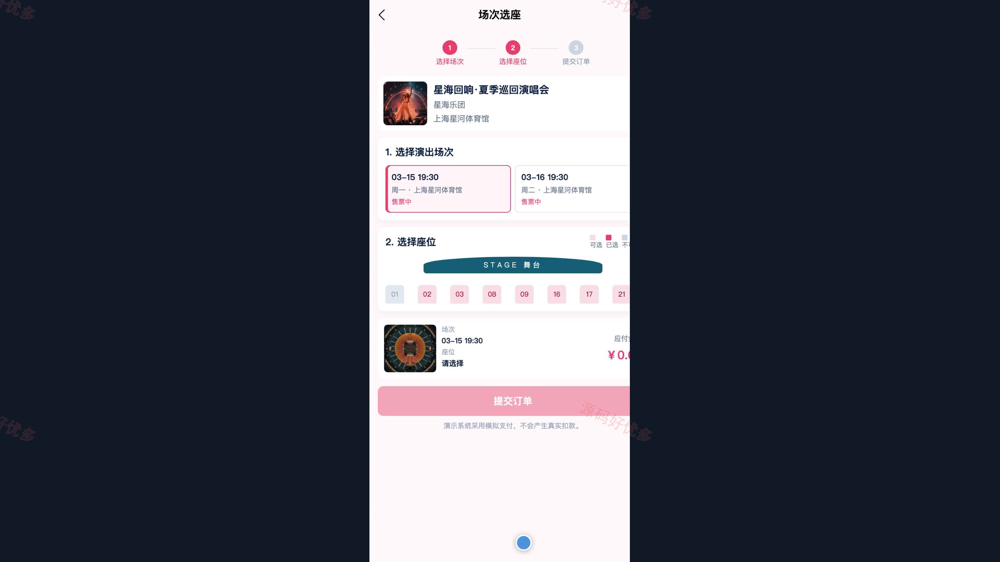
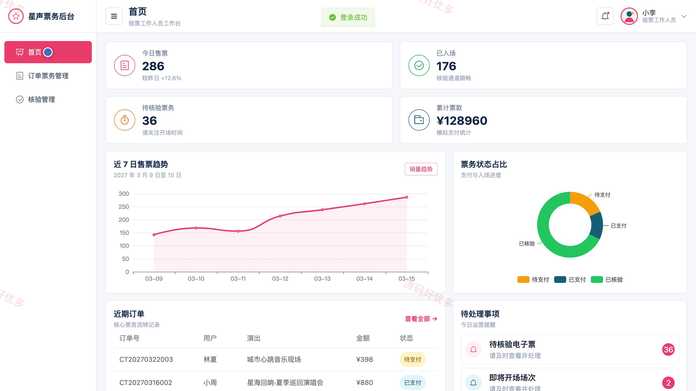
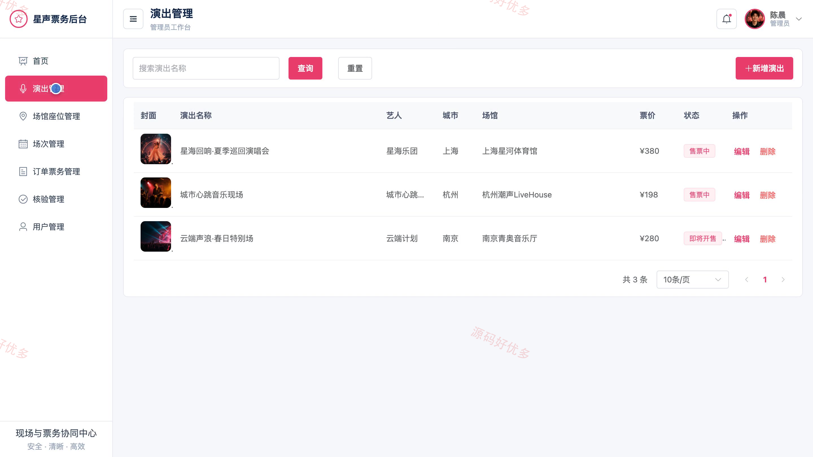

## 源码问题查看主页咨询

### 一、关键词
演唱会订票、在线票务、演出选座、电子票核验、文娱购票

### 二、作品包含
源码+数据库+万字设计文档+PPT+全套环境和工具资源+本地部署教程

### 三、项目技术
前端技术： Html、Css、Js、Vue3.4、Element-Plus、uniapp
后端技术：Java、SpringBoot3.2.0、MyBatis-Plus

### 四、运行环境要求
开发工具：IDEA/eclipse + VSCODE + HBuilder X + 微信开发者工具

数据库：MySQL5.7+（共10张表）

数据库管理工具：Navicat10以上版本

环境配置软件： JDK17 + Maven3.6

前端Nodejs：16+

浏览器：谷歌浏览器

### 五、项目介绍
项目编号：bs038B

本项目面向演唱会门票预订与入场核验场景，购票用户可在微信小程序浏览演出、查看场次与票价、选座下单、模拟支付并管理收藏和电子票；验票工作人员通过管理端核验取票码、查询订单并处理异常票务；管理员负责演出、场馆座位、场次、用户、订单与运营数据维护。

角色：购票用户、验票工作人员、管理员

购票用户功能：账号注册与登录、演出浏览与搜索、演出详情查看、演出收藏管理、场次与座位选择、购票下单与模拟支付、电子票与取票码查看、订单及核验状态跟踪。

验票工作人员功能：取票码核验、核验记录查看、票务订单查询、异常票务登记、场次票务查看。

管理员功能：购票用户与验票人员管理、演出信息管理、场馆座位管理、演出场次管理、订单票务管理、取票码与核验状态管理、运营数据统计。

### 六、运行截图

